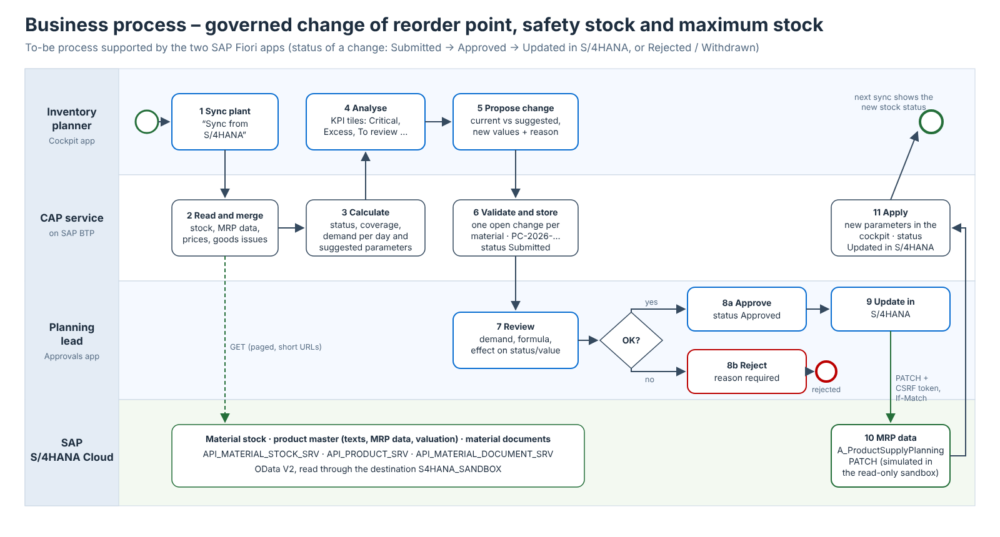
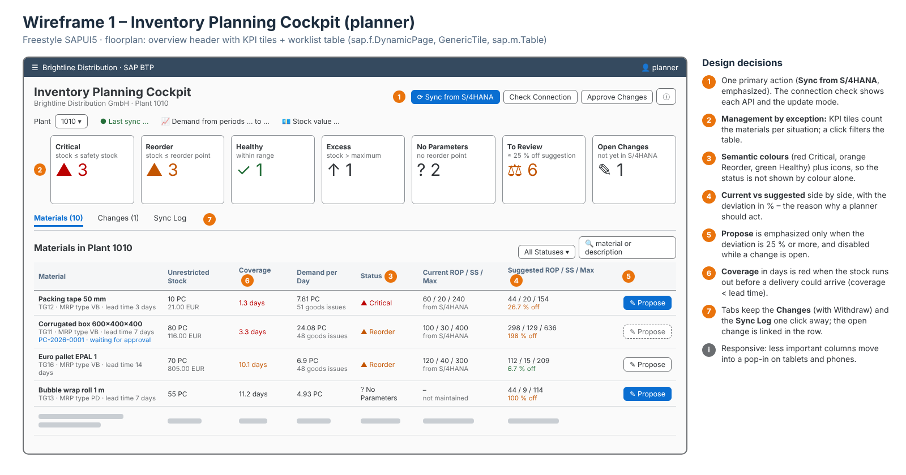
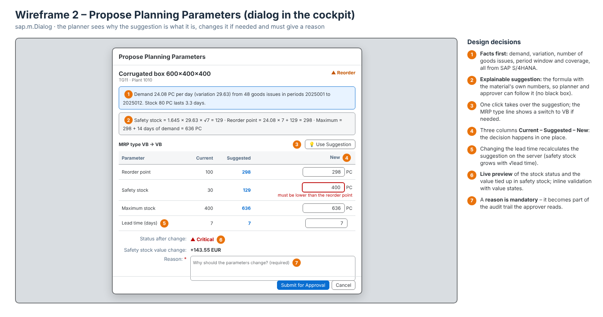
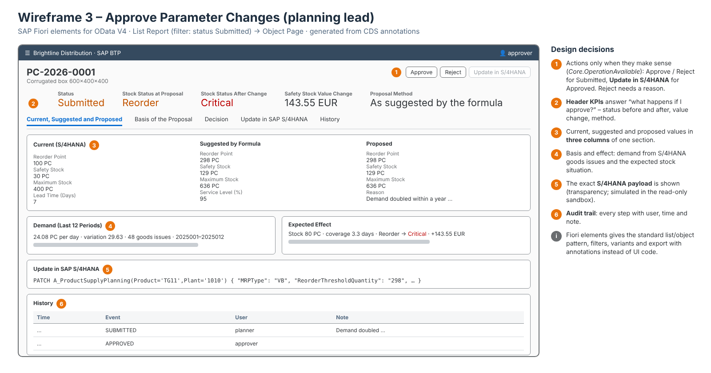
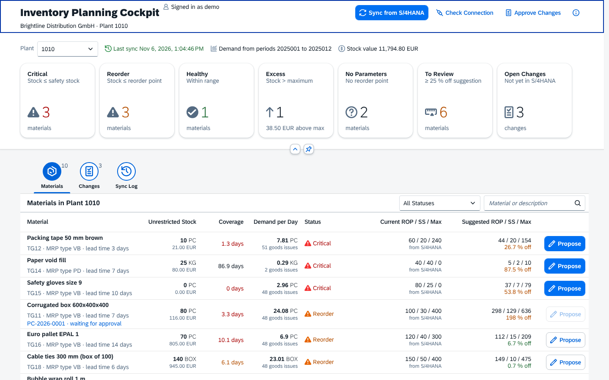
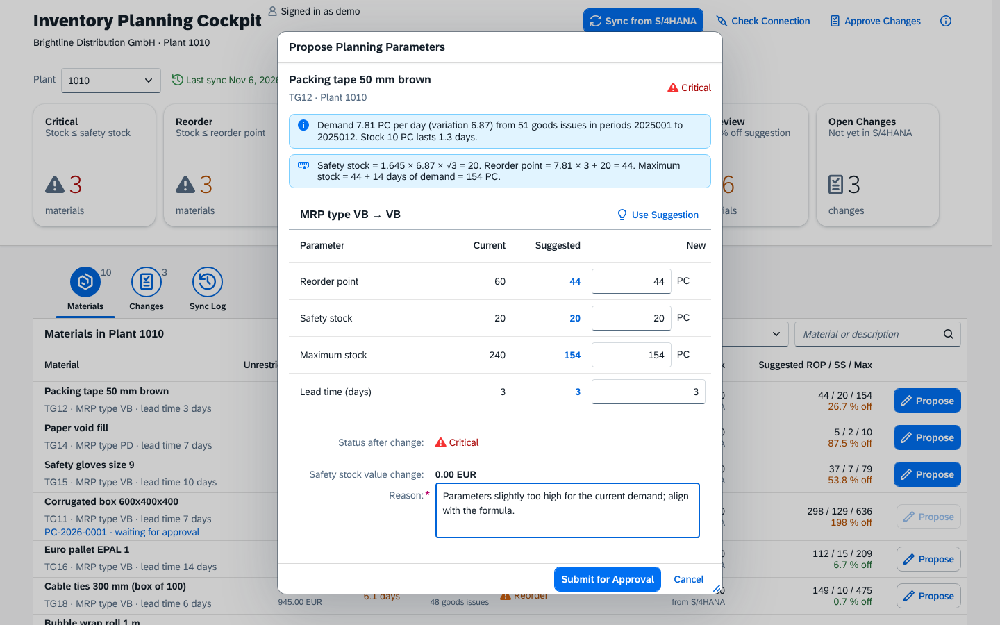
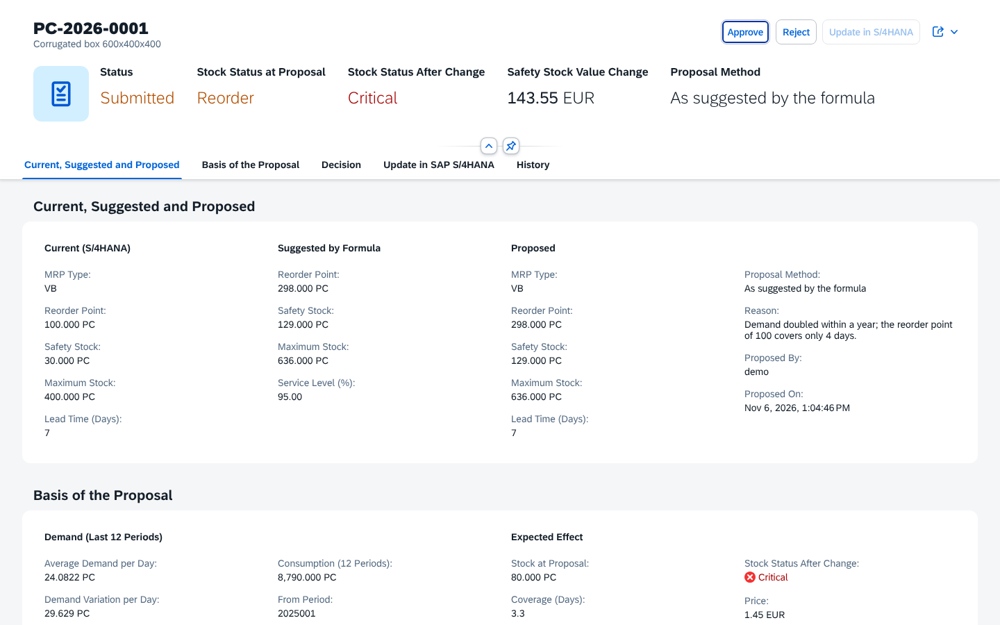
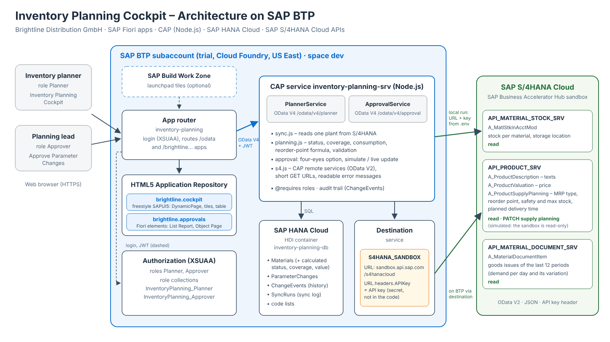

# Project 4 – SAP Fiori on SAP BTP: Inventory Planning Cockpit

**Company (fictional):** Brightline Distribution GmbH, a wholesale distributor of packaging and warehouse supplies.
**Solution:** two SAP Fiori apps on SAP BTP. They check stock against the planning parameters in SAP S/4HANA,
suggest a better reorder point, safety stock and maximum stock from real consumption, and send every change
through an approval before it is written back to SAP S/4HANA.

> Images referenced below are in `docs/images`. Screenshots marked *preview* were taken with the local test data,
> so replace them with your own screenshots from SAP BTP and the S/4HANA sandbox for the report.

---

## 1. How the project meets the brief

The brief for Project 4: *"Design and develop a complete SAP Fiori application on SAP BTP for a business scenario of
your choice. Students must define the business requirements, design the user interface, implement the application,
connect it to a backend service or API, and demonstrate the complete end-to-end solution."*

| Requirement in the brief | How the project meets it | Evidence for the report |
|---|---|---|
| Business scenario of your choice | Governance of MRP planning parameters (reorder point, safety stock, maximum stock) at a distributor. A different process from Project 2 (supplier invoices) and Project 3 (procurement): this app never buys anything. It decides *how much stock to keep*. | Chapter 2 |
| Define the business requirements | Problem, stakeholders, user stories with acceptance criteria, business rules, non-functional requirements | Chapters 2–4 |
| Design the user interface | Fiori floorplans chosen per role, three wireframes with design decisions, Fiori design principles | Chapter 5, `wireframe-*.png` |
| Implement the application | CAP service (Node.js) with two OData V4 services, a freestyle SAPUI5 app and an SAP Fiori elements app, SAP HANA Cloud | Chapters 6–8, source code |
| Connect it to a backend service or API | Three SAP S/4HANA Cloud APIs through the BTP destination `S4HANA_SANDBOX`: read stock, MRP data, prices and goods issues; write the MRP data back (PATCH, simulated in the read-only sandbox) | Chapter 7, sync log, `[s4]` log lines |
| Complete SAP Fiori application **on SAP BTP** | Deployed as an MTA on Cloud Foundry: app router, HTML5 Application Repository, XSUAA roles, HDI container, destination; optional SAP Build Work Zone tiles | Chapter 6, `RUN-IN-BAS.md` E–H |
| Demonstrate the end-to-end solution | Sync → analyse → propose → approve → update S/4HANA → cockpit shows the new status; 5-minute demo script | Chapter 11 |
| Own design decisions, justified; no lecture example | Decision log with alternatives | Chapter 9 |
| Document how Generative AI was used | Tools, stages, prompts, generated parts, checks and corrections, before/after examples, benefits and limitations | Chapter 12 |

---

## 2. Business scenario

### 2.1 Situation and problem

Brightline keeps about 200 stocked materials per plant in SAP S/4HANA. Replenishment is planned with
**reorder-point planning** (MRP type VB): when the stock falls to the reorder point, MRP proposes an order.
This only works if three numbers per material are right:

- **Reorder point (ROP)** – the stock that covers the demand during the replenishment lead time, plus a buffer
- **Safety stock (SS)** – the buffer against demand that is higher than average
- **Maximum stock (MAX)** – the upper limit; orders fill up to it

Today these parameters are set once when the material is created and then forgotten. Demand changes, but the
parameters do not:

- Too **low** → the material runs out before the next delivery arrives (lost sales, rush orders).
- Too **high** → capital is tied up in excess stock and warehouse space.
- Nobody sees *which* materials have outdated parameters, changes are made by gut feeling directly in the
  material master, and there is no record of who changed what and why.

### 2.2 Goal

A planner sees, per plant and at a glance, where the stock situation is critical or excessive and which
parameters no longer fit the real consumption. The system suggests parameters with a transparent formula.
Every change is justified, approved by the planning lead (four-eyes principle possible) and then written to
SAP S/4HANA, with a complete audit trail.

### 2.3 Why this scenario (and how it differs from Projects 2 and 3)

| Project | Process | Main object |
|---|---|---|
| 2 | Finance – supplier invoices (with Generative AI) | Supplier invoice |
| 3 | Procurement for small electronics retailers | Purchase requisition / order |
| **4** | **Inventory planning – master data governance** | **MRP parameters of a material (A_ProductSupplyPlanning)** |

Project 4 does not create purchase requisitions, orders or invoices. It improves the *planning master data*
that later drives MRP.

### 2.4 Stakeholders and roles

| Stakeholder | Role in the app | Goals |
|---|---|---|
| Inventory planner | `Planner` (role collection `InventoryPlanning_Planner`) | Find problem materials fast, propose better parameters with evidence |
| Planning lead | `Approver` (role collection `InventoryPlanning_Approver`) | Decide quickly with all facts, keep control of stock value, audit trail |
| Warehouse / finance (informed) | – | Fewer stock-outs, less capital tied up |
| IT / BTP administrator | BTP cockpit | Secure integration, roles, no secrets in code |

---

## 3. Business requirements

### 3.1 User stories and acceptance criteria

| ID | As a … | I want to … | Acceptance criteria |
|---|---|---|---|
| BR-01 | planner | read the current situation of a plant from SAP S/4HANA with one click | Stock, descriptions, MRP data, prices and goods issues are read; the result (OK / PARTIAL / FAILED) and the counts appear in a sync log |
| BR-02 | planner | see how many materials are Critical, Reorder, Healthy, Excess or have no parameters | KPI tiles with counts; a click filters the table |
| BR-03 | planner | see how long the stock lasts | Coverage in days = stock ÷ average demand per day, red when shorter than the lead time |
| BR-04 | planner | get suggested parameters based on the real consumption | Suggestion from the goods issues of the last 12 periods (formula in 4.2), with deviation from the current reorder point |
| BR-05 | planner | find materials whose parameters are outdated | Tile and filter *To review*: reorder point 25 % or more away from the suggestion (or none maintained) |
| BR-06 | planner | propose new parameters with a reason | Dialog with current, suggested and new values; validation; reason required; preview of the stock status and the value change |
| BR-07 | planner | withdraw a proposal that is no longer needed | Possible while the change is not yet in SAP S/4HANA |
| BR-08 | planning lead | see all open proposals with the facts | List of submitted changes; object page with current vs suggested vs proposed, demand, effect |
| BR-09 | planning lead | approve or reject | Approve with optional note; reject only with a reason; the decision is logged |
| BR-10 | planning lead | write approved parameters to SAP S/4HANA | *Update in S/4HANA* sends the change to `A_ProductSupplyPlanning`; the payload and time are stored; the cockpit uses the new values |
| BR-11 | auditor | trace every change | History per change: who, when, what, why |

### 3.2 Non-functional requirements

| ID | Requirement | Implementation |
|---|---|---|
| NFR-01 | Role-based access | XSUAA scopes `Planner` / `Approver`, `@requires` on the services, role collections in the MTA |
| NFR-02 | No secrets in the code | API key only in `.env` (git-ignored) locally and in the BTP destination property `URL.headers.APIKey` |
| NFR-03 | Robust integration | Stock is mandatory (FAILED run if missing); other APIs optional (PARTIAL run, stored values are kept); readable messages for 401/403/404/429 |
| NFR-04 | Performance | Paged reads (500 rows), parallel calls (4), filters pushed to SAP S/4HANA, goods issues only for the 12-period window |
| NFR-05 | Data consistency | One open change per material; the approval is blocked if the parameters changed after the proposal |
| NFR-06 | Usability | SAP Fiori design (Horizon theme), semantic colours with icons, responsive tables, i18n texts |
| NFR-07 | Testability | 26 automated tests against a local S/4HANA stand-in |

---

## 4. Business rules

### 4.1 Stock status (calculated on read in the database)

| Status | Rule | Colour |
|---|---|---|
| N – No parameters | no reorder point maintained | neutral |
| C – Critical | stock ≤ safety stock | red |
| R – Reorder | stock ≤ reorder point | orange |
| E – Excess | maximum stock > 0 and stock > maximum stock | blue |
| O – Healthy | otherwise | green |

Only *own unrestricted-use stock* counts (stock type 01 without special stock indicator). Quality inspection,
blocked and consignment stock are shown as "other stock".

### 4.2 Suggested parameters (reorder-point method, 95 % service level)

From the goods issues (movement types 201, 221, 231, 241, 261, 281, 291, 601, 641, 643, minus their reversals)
of the last 12 fiscal periods:

- *d* = average demand per day, *σ* = standard deviation of the daily demand
  (from the monthly quantities: σ_day = σ_month / √30.4), *L* = lead time in days
- **Safety stock** SS = 1.645 × σ × √L (z = 1.645 for a 95 % service level)
- **Reorder point** ROP = d × L + SS
- **Maximum stock** MAX = ROP + 14 days of demand (at least the minimum lot size, rounded to the rounding quantity)
- Fewer than 3 goods issues: the variation is not reliable, so SS = 0.5 × d × L.
- No goods issues: no suggestion; the planner enters the values (method *Manual*).

The 12-period window ends at the newest period with goods issues in the plant (the sandbox holds historical data).

*Example (test data, material TG11):* d = 24.08 PC, σ = 29.63, L = 7 → SS = 1.645 × 29.63 × √7 = 129;
ROP = 24.08 × 7 + 129 = 298; MAX = 298 + 14 × 24.08 = 636. The current reorder point is 100, a deviation of 198 %.

### 4.3 Change rules

- A proposal needs ROP > 0, SS < ROP, MAX = 0 or MAX > ROP, lead time 1–365 days and a reason (≥ 5 characters).
- If the MRP type does not plan with a reorder point (e.g. PD), the change switches it to **VB**.
- One open change (Submitted or Approved) per material.
- Status flow: **Submitted → Approved → Updated in S/4HANA**, or **Rejected** (reason required) / **Withdrawn**.
- Optional four-eyes principle (`FOUR_EYES=true`): nobody approves their own proposal.
- *Update in S/4HANA*: `simulate` (default, because the sandbox is read-only) or `live` (`S4_WRITE_MODE=live`,
  sends `PATCH A_ProductSupplyPlanning` with CSRF token and `If-Match`).
- After the update, the cockpit uses the approved values until SAP S/4HANA itself holds them.

---

## 5. User interface design

### 5.1 Floorplans per role

| App | User | Floorplan and technology | Why |
|---|---|---|---|
| **Inventory Planning Cockpit** (`brightline.cockpit`) | Planner | Freestyle SAPUI5: `sap.f.DynamicPage` with KPI tiles (`GenericTile`), worklist table, dialog | Needs a custom overview (tiles as filters), calculations shown in the table, and an interactive dialog with live preview and server recalculation. Fiori elements has no pattern for this. |
| **Approve Parameter Changes** (`brightline.approvals`) | Planning lead | SAP Fiori elements for OData V4: List Report + Object Page | A standard approval worklist. Annotations give filters, variants, export, header KPIs, sections and actions without UI code. |

### 5.2 Wireframes

### 5.3 SAP Fiori design principles applied

- **Role-based:** one app per role; buttons and services are protected by roles (*Approve Changes* only for approvers).
- **Adaptive:** responsive tables (columns pop in on small screens), cozy/compact density.
- **Simple:** one primary action per screen (Sync, Submit for Approval, Approve); management by exception with tiles.
- **Coherent:** SAP Horizon theme, standard controls and floorplans, semantic colours always with icon or text.
- **Delightful/transparent:** the suggestion is explained with the material's own numbers; the approver sees the
  exact SAP S/4HANA payload.

### 5.4 Result (preview with test data)

---

## 6. Architecture

| Layer | Component | Purpose |
|---|---|---|
| UI | Two SAPUI5 apps in the **HTML5 Application Repository** | Cockpit (freestyle) and approvals (Fiori elements) |
| Entry | **App router** `inventory-planning` | Login with XSUAA, routes `/odata/...` to the CAP service and the apps from the repository |
| Security | **XSUAA** | Scopes and role templates `Planner`, `Approver`; role collections created by the MTA |
| Service | **CAP** `inventory-planning-srv` (Node.js) | OData V4 services, business rules, S/4HANA integration |
| Persistence | **SAP HANA Cloud**, HDI container `inventory-planning-db` | Materials snapshot, changes, history, sync log |
| Connectivity | **Destination** `S4HANA_SANDBOX` | URL and API key of the S/4HANA system, outside the code |
| Backend | **SAP S/4HANA Cloud** (Business Accelerator Hub sandbox) | Source of stock, product master and goods movements; target of the parameter update |
| Launchpad (optional) | **SAP Build Work Zone, standard edition** | Tiles for both apps (inbounds `InventoryPlanning-display`, `ParameterChange-approve`) |

Everything is deployed with one MTA archive (`mta.yaml`): `npm run build:mta`, `npm run deploy`.

---

## 7. Backend integration with SAP S/4HANA

| API (OData V2) | Entity | Fields used | Use |
|---|---|---|---|
| `API_MATERIAL_STOCK_SRV` | `A_MatlStkInAcctMod` | Material, Plant, StorageLocation, InventoryStockType, InventorySpecialStockType, MatlWrhsStkQtyInMatlBaseUnit, MaterialBaseUnit | Stock per material (required) |
| `API_PRODUCT_SRV` | `A_ProductDescription` | Product, Language, ProductDescription | Material texts |
| | `A_ProductSupplyPlanning` | MRPType, ReorderThresholdQuantity, SafetyStockQuantity, MaximumStockQuantity, MinimumLotSizeQuantity, LotSizeRoundingQuantity, PlannedDeliveryDurationInDays | Current parameters (read) and the update (PATCH) |
| | `A_ProductValuation` | InventoryValuationProcedure, StandardPrice, MovingAveragePrice, PriceUnitQty, Currency | Stock value, value of the safety stock change |
| `API_MATERIAL_DOCUMENT_SRV` | `A_MaterialDocumentItem` | Material, GoodsMovementType, QuantityInBaseUnit, FiscalYearPeriod | Consumption of the last 12 periods |

How the connection works:

- The APIs are **CAP remote services** (`cds.requires` in `package.json`) with small hand-written CDS models in
  `srv/external` that contain only the fields the app needs.
- **Locally** the app calls the sandbox URL and adds the API key from `.env` as `APIKey` header.
  **On SAP BTP** the `[production]` profile uses the destination `S4HANA_SANDBOX`; the header comes from the
  destination property `URL.headers.APIKey`.
- Filters run in SAP S/4HANA (plant, material lists, period window, movement-type ranges). Every URL is kept below
  1,000 characters, because CAP would otherwise wrap a long GET into an OData `$batch` request.
- **Write-back:** `PATCH A_ProductSupplyPlanning(Product='…',Plant='…')` with a CSRF token and `If-Match: *`
  (tested against the local stand-in). In the read-only sandbox the update is simulated and the exact payload is
  stored and shown, so the integration point is visible in the demo.

---

## 8. Data model and services

| Entity | Content |
|---|---|
| `Materials` (key material + plant) | Stock snapshot, current parameters and their source (S4 / APPROVED / NONE), price, consumption, suggestion; calculated `status`, `coverageDays`, `stockValue`, `deviationPct`, `reviewNeeded` |
| `ParameterChanges` | Change number `PC-YYYY-NNNN`, current and new values, basis (demand, method, suggestion), effect (status before/after, value change), decision, S/4HANA update (mode, target, payload) |
| `ChangeEvents` | History per change (SUBMITTED, APPROVED, REJECTED, WITHDRAWN, S4_UPDATED) with user and time |
| `SyncRuns` | Log of every synchronisation (result, counts, duration, message) |
| `StockStatus`, `ChangeStatus` | Code lists with names and criticality |

| Service | Path | Role | Operations |
|---|---|---|---|
| `PlannerService` | `/odata/v4/planner` | Planner | `syncFromS4`, `kpis`, `plants`, `testS4Connection`, `whoAmI`; on Materials: `suggestFor(leadTimeDays)`, `proposeChange(...)`; on Changes: `withdraw` |
| `ApprovalService` | `/odata/v4/approval` | Approver | on Changes: `approveChange`, `rejectChange`, `updateS4` |

---

## 9. Technical decisions

| Decision | Alternatives considered | Reason |
|---|---|---|
| CAP (Node.js) on Cloud Foundry | ABAP RAP; SAP Build Apps | Same stack as in class and Project 2, runs in the BAS trial, OData V4 and Fiori elements support built in |
| Two apps for two roles | One app with role-dependent views | Clear separation of duties; each app uses the floorplan that fits its task |
| Freestyle cockpit + Fiori elements approvals | Both Fiori elements | The cockpit needs tiles as filters and an interactive dialog; the approval is a standard list/object pattern where annotations are faster and more consistent |
| Snapshot of S/4HANA data in HANA Cloud | Read S/4HANA live on every screen | The suggestion needs 12 periods of goods issues per material (hundreds of rows): calculating once per sync keeps the UI fast; KPIs and filters run in the database |
| Status, coverage, value, deviation as calculated elements | Calculate in JavaScript | The database can filter and sort by them (tiles, *To review*) |
| Reorder-point formula with 95 % service level | Fixed % buffer; machine learning forecast | Standard, explainable method that a planner and an approver can check by hand |
| Approval and audit trail in the app | Change directly in the material master | Four-eyes principle and traceability are the business goal |
| Update simulated by default, `live` switch | Only read | The sandbox is read-only; the switch shows how the same code updates a real system |
| Destination for URL and key | Credentials in `package.json` | No secrets in the repository; system can be changed without a new deployment |
| Short GET URLs instead of `$batch` | Let CAP batch long URLs | Plain GET requests are what the sandbox supports reliably |

---

## 10. Testing

`npm test` runs 26 automated tests (Node.js test runner, `@cap-js/cds-test`) against a local S/4HANA stand-in
(`test/mock-s4`), which implements the used entities, `$filter`/`$select`/`$orderby`/paging, the API-key check,
CSRF tokens and the PATCH:

- Business rules: status, consumption window with reversals, formula (exact numbers), validation, MRP type switch,
  valuation and stock rules, merge of approved parameters, change numbers, PATCH payload, URL batches
- Services: connection check, sync (only GET requests, API key on every call, 12-period filter), KPIs, suggestion
  for another lead time, proposal validation and duplicate block, roles, approval and simulated update, rejection
  and withdrawal, four-eyes principle, live PATCH with CSRF and If-Match, failed update can be retried, 60 materials
  with long numbers without `$batch`, partial sync keeps stored values, rejected API key logged as FAILED run

Manual end-to-end test: the flow of chapter 11 locally and on SAP BTP.

---

## 11. Demo script (about 5 minutes)

1. **Problem (30 s):** parameters set once, demand changed → stock-outs and excess stock, no control.
2. **Architecture (45 s):** one slide with the architecture picture: Fiori apps → app router → CAP → HANA Cloud;
   destination → three S/4HANA APIs.
3. **Cockpit (90 s):** *Sync from S/4HANA* (show the sync log), tiles, filter *To review*, a material whose
   reorder point is far from the suggestion. Open **Propose**: demand, formula with its own numbers, change the lead
   time once to show the recalculation, *Use Suggestion*, status preview, reason, *Submit for Approval*.
4. **Approval (60 s):** second browser window as approver (or the same user with both roles): list of submitted
   changes, object page with current vs suggested vs proposed, header KPIs, **Approve**, **Update in S/4HANA**,
   payload and history.
5. **Result (30 s):** back in the cockpit: new parameters *approved in PC-…*, new status, open changes −1.
6. **Generative AI (30 s):** how AI was used and what we checked (chapter 12).

---

## 12. Use of Generative AI

> Fill in the parts in *italics* with your own facts and screenshots. Keep the statements true: describe what you
> actually did. If the person presenting this project did not write all the prompts, say who did what (for example:
> "prompts in a Claude chat by A.; setup, deployment, tests and the extension X by B.").

| Point | Content |
|---|---|
| Tool | Claude (Anthropic), used in a chat as a development assistant. *Optional: SAP Joule in SAP Business Application Studio, if you also used it.* |
| Stages | Choice and re-evaluation of the business scenario against the brief; requirements and business rules; data model and services; S/4HANA integration; both UIs; automated tests and the S/4HANA stand-in; deployment descriptors; diagrams, wireframes and this documentation |
| Prompts (examples from the team's chat) | "I want to do Project 4 now … guide me similarly [to Project 2]." · "Project 4 even the scenario is different right? … my friend doing Project 3 is doing procurement for small electronic retailers … we have to keep all project scenarios different … re-evaluate for me … do everything as per the assignment doc." *Add your own prompts (for example when you asked an AI to explain or extend a part) and screenshots of the chat.* |
| Generated or assisted | `db/schema.cds`, `srv/*.cds`, `srv/*.js`, `srv/lib/*.js`, `srv/external/*.cds`, `app/cockpit/**`, `app/approvals/**`, `test/**`, `mta.yaml` changes, diagrams and wireframes, this document |
| Integration into SAP | *Uploaded the package to BAS, ran `npm install`, `npm test`, `cds watch`; configured the destination, HANA Cloud and role collections; built and deployed the MTA to SAP BTP (screenshots).* |
| Checks and corrections (by AI and by us) | Field names compared with the API definitions in the SAP Business Accelerator Hub; every rule covered by a test; *your own checks: e.g. compared the suggested values of one material with a manual calculation in Excel; checked the data in the sandbox.* |
| Before / after examples | (1) **Scenario:** the first version was a *Stock Replenishment Cockpit* that created purchase requisitions. After re-checking against the brief and the other projects, AI and we changed it to parameter governance, because purchasing overlapped with Project 3. (2) **`$batch`:** the first version sent long GET URLs, which CAP turns into `$batch` requests; the tests revealed it and the batches were then sized to keep every URL short. (3) **Reversals:** a cancelled goods issue was first both skipped and subtracted (counted twice); corrected so that issue and reversal cancel each other out. (4) **Database division:** calculated coverage and value were changed to decimal division, because SQLite divides integers without decimals. (5) **"To Review" filter:** the tile counted 6 materials but the filtered table was empty; the browser end-to-end test showed that SQLite compared the decimal deviation with a text parameter. Fixed with the Boolean field `reviewNeeded` and a new automated test. |
| Benefits | Much faster start (complete CAP + Fiori structure in hours instead of days), explanations of SAP APIs and CDS annotations, generated tests and stand-in that found real bugs, consistent documentation |
| Limitations | The AI could not access our BTP account or the real sandbox, so connection, data and deployment had to be checked by us; it can name wrong API fields if not checked; its first scenario choice did not consider the other projects; the generated code had to be read and understood to present and defend it |

Evidence to add: screenshots of the chat prompts, one generated code example (e.g. `suggestParameters` in
`srv/lib/planning.js`) next to the running result in the app, the test run, and the before/after of the scenario.

---

## 13. Limitations and possible extensions

- The sandbox is read-only, so the update is simulated there; `S4_WRITE_MODE=live` with a real S/4HANA system
  (and a destination with write authorisation) performs the PATCH.
- The sandbox holds historical goods movements; the window therefore ends at the newest period found.
- Constant lead time is assumed; lead-time variation, seasonality or a forecast could be added.
- Extensions: SAP Build Work Zone tiles, e-mail or SAP Build Process Automation for the approval, scheduled sync
  (job), mass proposals for all materials *To review*.
